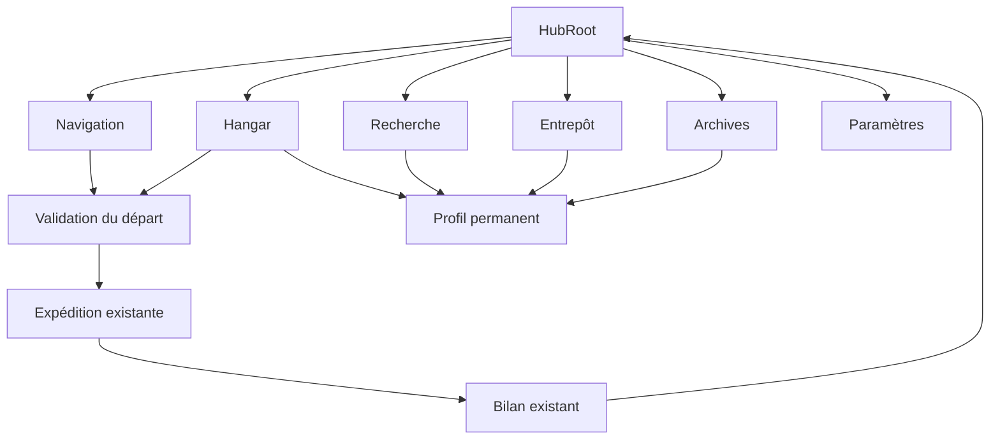

# Architecture proposée (à adapter après audit)

## Scènes et layout
HubRoot (Control) → MarginContainer → VBoxContainer → Header + HBoxContainer (Sidebar, PageHost, DetailPanel) + Footer. Chaque page est une scène Control indépendante. Utiliser Theme partagé, containers, ancres, ScrollContainer, focus clavier et signaux. Graphe de recherche : Control personnalisé ou GraphEdit non éditable, après test de lisibilité. Ne pas imposer de nouveaux autoloads si GameData/SaveGame/RunState suffisent.

## Contrats proposés
Définitions immuables : planet_id, difficulty_id, ship_id, weapon_id, ability_id, module_id, skill_id, resource_id. Profil mutable : inventaire permanent, rangs de compétences, déblocages, presets, objectifs épinglés, historique, préférences. Preset : id, name, ship_id, weapon_id, ability_id, module_ids. Pas de mining_tool_id dans le nouveau modèle. Migrer les anciennes données seulement après inspection ; sauvegarder une copie avant migration. La sélection de navigation n'est pas une run. Créer un snapshot du loadout validé au lancement, sans références Node sérialisées.

## Transactions et signaux
Achat : relire prérequis et coûts → vérifier stock → appliquer ensemble → persister selon mécanisme existant → notifier UI. En cas d'échec, ne pas afficher achat réussi ; conserver ou restaurer état cohérent. Départ : empêcher double clic, valider identifiants, slots, unicité, accès planète/difficulté et absence de run active ; appeler le flux réel ; réactiver le bouton en cas d'échec. Signaux proposés : profile_changed, loadout_changed, selection_changed, launch_failed. Éviter les connexions dupliquées et recalculs par frame.

## Livraison par étapes
1. Audit et thème + shell + navigation entre pages.
2. Navigation et Hangar branchés aux données réelles ; lancement et retour réel.
3. Recherche, achat, épinglage, Entrepôt.
4. Archives, paramètres, reprise de sauvegarde, états d'erreur.
5. Vérification résolution, clavier, persistance, tests de régression.
